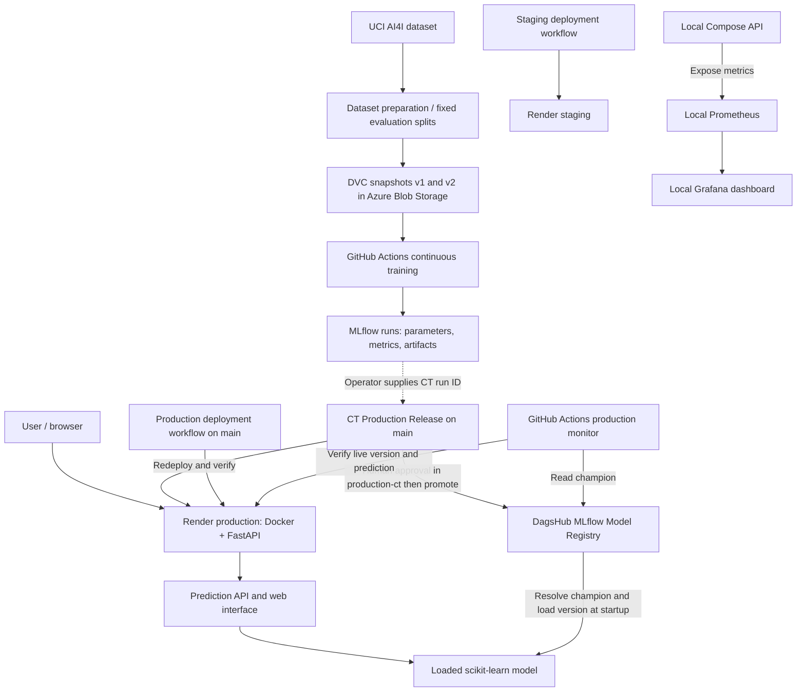

# PredictMaint AI

**Industrial Predictive Maintenance | Machine Learning in Production — Final Project**

PredictMaint AI is a Dockerized web application that estimates the probability of industrial machine failure from six operating measurements. It demonstrates a reproducible MLOps lifecycle: versioned data, experiment tracking, a shared model registry, automated tests, staging and production deployments, controlled continuous training, and model rollback.

**Live application:** [PredictMaint AI — Production](https://predictmaint-ai-production.onrender.com/)
**Interactive API documentation:** [Swagger UI](https://predictmaint-ai-production.onrender.com/docs)
**Staging application:** [Render Staging](https://predictmaint-ai-staging.onrender.com/)
**Experiment tracking and model registry:** [DagsHub / MLflow](https://dagshub.com/Abdel380/predictmaint-ai.mlflow/)

> **Production status (25 November 2026).** Render serves MLflow model `predictmaint-ai`, alias `champion`, version **1**. During the production rehearsal, the team promoted v3, verified it online, then deliberately restored v1 for the presentation. The final production monitor confirmed that Render and MLflow agreed. [Final synchronization check](https://github.com/eugeniettc/final-project-ml-in-prod/actions/runs/45719605125)

The Git tag `v1.0-demo-stable` marks commit `b2044c0` on `main`. It preserves the repository snapshot. MLflow aliases and artifacts, data in Azure, and Render configuration and deployment state are managed separately. [Tagged code](https://github.com/eugeniettc/final-project-ml-in-prod/tree/v1.0-demo-stable)

## 1. What the application does

The application predicts **machine failure (binary classification)** using the [AI4I 2020 Predictive Maintenance dataset](https://archive.ics.uci.edu/dataset/601/ai4i). The dataset contains synthetic industrial operating observations, so the application is an **academic demonstration**, not a safety-certified industrial maintenance system.

The user supplies six features:

| API field | Meaning | Unit / accepted values |
| --- | --- | --- |
| `type` | Product quality category | `L`, `M`, or `H` |
| `air_temperature` | Air temperature | Kelvin, positive |
| `process_temperature` | Process temperature | Kelvin, positive |
| `rotational_speed` | Rotational speed | rpm, positive |
| `torque` | Machine torque | Nm, non-negative |
| `tool_wear` | Tool wear | Minutes, non-negative |

The response contains a binary prediction (`0`: no predicted failure; `1`: predicted failure), a `risk_score` between 0 and 1, and the **actual model name and version used for inference**.

### Try a live prediction

```bash
curl -X POST "https://predictmaint-ai-production.onrender.com/predict" \
  -H "Content-Type: application/json" \
  -d '{
    "type": "L",
    "air_temperature": 298.1,
    "process_temperature": 308.6,
    "rotational_speed": 1500,
    "torque": 40,
    "tool_wear": 20
  }'
```

The response has the following structure (**illustrative schema; values depend on the deployed model**):

```json
{
  "failure_prediction": 0,
  "risk_score": 0.01,
  "model_name": "predictmaint-ai",
  "model_version": "1"
}
```

Open [the web interface](https://predictmaint-ai-production.onrender.com/) to submit inputs without using the command line.

### Operational endpoints

| Endpoint | Method | Purpose |
| --- | --- | --- |
| `/` | GET | User-facing prediction interface |
| `/docs` | GET | Interactive OpenAPI / Swagger documentation |
| `/predict` | POST | Real-time inference with input validation |
| `/ready` | GET | Returns HTTP 200 only when a model is loaded; otherwise HTTP 503 |
| `/model-info` | GET | Registered model name, resolved alias, and loaded version |
| `/metrics` | GET | Prometheus-compatible application and prediction metrics |

To verify the model served by production:

```bash
curl -f https://predictmaint-ai-production.onrender.com/ready
curl -f https://predictmaint-ai-production.onrender.com/model-info
```

## 2. Architecture



**Technology stack:** Python, scikit-learn, FastAPI, Pydantic, Docker, DVC with Azure Blob Storage, MLflow Model Registry and Tracking on DagsHub, GitHub Actions, Render, Prometheus, Grafana, and structured logs.

**Model loading contract:** At FastAPI startup, the service resolves the MLflow `champion` alias to a concrete model version and loads that exact artifact. It does **not** automatically hot-reload when the alias changes. A model change requires an application restart or redeployment, followed by readiness and live-prediction verification. Local development and CI smoke tests can opt into mock inference with `ENABLE_MOCK_MODEL=true`.

## 3. Reproduce the application locally

### Requirements

- Git, Python 3.11, and Docker
- Internet access to reach the hosted model registry for **real** model inference
- Authorized DagsHub/MLflow credentials for **real** model inference
- Azure storage credentials to retrieve the versioned datasets with DVC

### Option A — Docker smoke test (mock model; no cloud credentials)

```bash
git clone https://github.com/eugeniettc/final-project-ml-in-prod.git
cd final-project-ml-in-prod
docker build -t predictmaint-ai:local .
docker run --rm -p 8000:8000 -e ENABLE_MOCK_MODEL=true predictmaint-ai:local
```

In a second terminal:

```bash
curl -f http://localhost:8000/ready
curl -f http://localhost:8000/model-info
```

The mock model reports version `mock-1.0`. **It is a testing fixture, not the approved MLflow champion.** Stop the container using `Ctrl+C`.

### Option B — Local FastAPI with the real MLflow champion

```bash
python -m venv .venv
source .venv/bin/activate               # macOS / Linux
# Windows PowerShell: .venv\Scripts\Activate.ps1
pip install -r requirements.txt
```

From the repository root, save these settings in a local, Git-ignored `.env` file and replace the credential placeholders. The startup command below loads the settings before importing the application.

```dotenv
MLFLOW_TRACKING_URI=https://dagshub.com/Abdel380/predictmaint-ai.mlflow
MLFLOW_TRACKING_USERNAME=<your_dagshub_username>
MLFLOW_TRACKING_PASSWORD=<your_dagshub_token>
MLFLOW_MODEL_NAME=predictmaint-ai
MLFLOW_MODEL_ALIAS=champion
ENABLE_MOCK_MODEL=false
```

Start and verify:

```bash
uvicorn app.main:app --env-file .env --host 0.0.0.0 --port 8000
# In another terminal:
curl -f http://localhost:8000/model-info
```

**Important:** `/ready` returns HTTP 503 if the approved model is unavailable; the application does not silently substitute the mock model in real-inference mode.

### Run automated tests

```bash
python -m pytest tests/ -v
python -m ruff check app ml tests --select E9,F63,F7,F82
```

The CI also builds the Docker image, starts it with a controlled mock model, and tests live HTTP endpoints. See [CI workflow](.github/workflows/ci.yml).

## 4. Data, training, and experiment tracking

The source is the **AI4I 2020 Predictive Maintenance dataset** (UCI, CC BY 4.0, synthetic observations). The two DVC dataset versions simulate a new batch of observations:

| Dataset snapshot | Training samples | Role |
| --- | ---: | --- |
| `data-v1` | 3,000 | Initial baseline |
| `data-v2` | 6,000 | New training batch (3,000 additional observations) |

The fixed validation and held-out test splits contain 2,000 records each. The test split is reserved for the predefined acceptance evaluation; champion and candidate are compared on the same held-out observations. Product identifiers and direct failure-mode indicators are excluded from model inputs to limit target leakage.

**Primary selection metric:** Average Precision (AP), appropriate for an imbalanced failure dataset (~3.39% failures). Higher is better. Supporting metrics include ROC-AUC, precision, recall and F1-score.

The three metric gates require candidate AP >= 0.40, an absolute AP improvement >= 0.02 against the champion, and recall >= 0.50 at threshold 0.5. The production release also checks model loading and live inference. These thresholds were chosen for the academic demonstration.

For exact DVC hashes, data provenance, experiment results and current promotion policy, see:

- [Dataset and DVC versioning](ml/README_data.md)
- [MLflow experiments, metrics, and promotion decisions](ml/README_experiments.md)
- [DagsHub model registry and experiment runs](https://dagshub.com/Abdel380/predictmaint-ai.mlflow/)

## 5. Branch strategy and CI/CD workflows

The repository uses a reviewed promotion path:

```text
feature/*  ->  dev  ->  staging  ->  main
       PR        PR         PR
```

Changes are developed on short-lived `feature/*` branches created from `dev`, reviewed through Pull Requests, and promoted sequentially. CI runs on PRs targeting `dev`, `staging`, and `main`. Which CI checks GitHub branch protection requires before merge remains to be confirmed.

| Workflow | Trigger | Action / validation |
| --- | --- | --- |
| [`ci.yml`](.github/workflows/ci.yml) | PR to `dev`, `staging`, or `main`; push to these branches; manual dispatch | Python syntax, Ruff critical checks, pytest, Docker build, mock-container smoke test |
| [`staging.yml`](.github/workflows/staging.yml) | Push or manual dispatch on `staging` for deployment | Validate build/tests, deploy Render staging, verify public readiness, model version, and prediction |
| [`production.yml`](.github/workflows/production.yml) | Push or manual dispatch on `main` for deployment | Validate build/tests, deploy Render production for the expected Git SHA, verify the live MLflow champion and prediction |
| [`continuous-training.yml`](.github/workflows/continuous-training.yml) | Push/PR to `dev` or manual dispatch | PRs run tests. Pushes to `dev` validate both datasets and check whether v2 needs training. On manual dispatch from `main`, `validate-only` checks the selected data and registry, and `train-and-check` also runs the retraining gate. A `TRAIN` decision leads to training, evaluation and a read-only promotion check. |
| [`ct-production-release.yml`](.github/workflows/ct-production-release.yml) | Manual dispatch on `main`, with `ct_run_id` and `release_mode` | Preflight comparison; optional protected promotion, Render redeployment and recovery logic |
| [`production-model-monitor.yml`](.github/workflows/production-model-monitor.yml) | At minutes 17 and 47 each hour, on manual dispatch, or after a production deployment/release workflow completes | Read the MLflow champion, verify readiness, model identity and a live prediction, then recheck the alias |

**Continuous-training release boundary:** Training and comparison do **not** automatically modify the production champion. The separate, explicitly authorized `CT Production Release` workflow performs a real promotion only after its preflight and production-environment authorization. A candidate that fails the quality gates must leave the champion unchanged and log the rejection reason.

For credentials, deployment reproduction, branch flow, and production incident handling, see [Deployment and Twelve-Factor documentation](DEPLOYMENT.md).

### Production rehearsal evidence (25 November 2026)

| Step | Verified outcome | Evidence |
| --- | --- | --- |
| Starting deployment | Render served champion v1. | [Production deployment](https://github.com/eugeniettc/final-project-ml-in-prod/actions/runs/45709532179) |
| Continuous Training | Training on `data-v2` produced an eligible candidate. All three quality gates passed, with an absolute AP gain of 0.0295. | [CT workflow](https://github.com/eugeniettc/final-project-ml-in-prod/actions/runs/45710611379) · [MLflow run `83942914196549e89ebb69a4dbb89844`](https://dagshub.com/Abdel380/predictmaint-ai.mlflow/#/experiments/2/runs/83942914196549e89ebb69a4dbb89844) |
| Protected release | A reviewer approved `production-ct`. The release promoted v3, automatically redeployed Render and verified inference. | [Approved release](https://github.com/eugeniettc/final-project-ml-in-prod/actions/runs/45712120942) |
| Post-promotion monitor | MLflow and the live API agreed on v3. | [Synchronization check](https://github.com/eugeniettc/final-project-ml-in-prod/actions/runs/45712976568) |
| Controlled rollback | After a successful dry-run, `ml.rollback` restored v1. Production was redeployed and verified over HTTP. | [MLflow rollback audit](https://dagshub.com/Abdel380/predictmaint-ai.mlflow/#/experiments/2/runs/87a607ce17f74f329995e2f4db0a085b) · [Render and HTTP verification](https://github.com/eugeniettc/final-project-ml-in-prod/actions/runs/45716691906) |
| Final state | The `main` deployment at `b2044c0` passed. The production monitor confirmed champion v1. | [Final deployment](https://github.com/eugeniettc/final-project-ml-in-prod/actions/runs/45718935803) · [Final monitor](https://github.com/eugeniettc/final-project-ml-in-prod/actions/runs/45719605125) |

The rehearsal recorded **46 passing automated tests**. The production workflow builds `predictmaint-ai:production` for validation and checks the Git SHA reported by Render. The immutable image digest actually served by Render remains unconfirmed. Python package versions in `requirements.txt` are unpinned.

### Earlier CI/CD evidence

- [Rollback implementation and tests — PR #14](https://github.com/eugeniettc/final-project-ml-in-prod/pull/14)
- [Staging validation — PR #15](https://github.com/eugeniettc/final-project-ml-in-prod/pull/15)
- [Production rollout — PR #16](https://github.com/eugeniettc/final-project-ml-in-prod/pull/16)
- [Production deploy with a live prediction and champion v2](https://github.com/eugeniettc/final-project-ml-in-prod/actions/runs/45695248713)
- [Production model synchronization monitor](https://github.com/eugeniettc/final-project-ml-in-prod/actions/runs/45696050322)

## 6. Rollback and failure recovery

`ml/rollback.py` supports a dry-run (default) and an explicit `--execute` flag. It verifies the expected current champion, the previous approved version, MLflow registration/provenance and a local inference check **before** changing the alias. The application must then restart/redeploy and pass live HTTP verification.

The production rehearsal restored **v3 → v1** on Render. An earlier exercise restored **v4 → v1** on the isolated registered model `predictmaint-ai-ct-demo-henri-fixed` and verified `/model-info` and `/predict` on a local FastAPI instance.

- [Complete rollback commands and incident runbook](DEPLOYMENT.md#4-mlflow-model-rollback)
- [Isolated v4 → v1 rollback audit](https://dagshub.com/Abdel380/predictmaint-ai.mlflow/#/experiments/2/runs/62ee72d6e93a41de99705dbedd304dcd)

Controlled tests cover automatic recovery after a deployment failure. The production rehearsal exercised a deliberate rollback following a successful release. No deployment failure was induced on Render.

## 7. Observability

FastAPI exposes `/metrics` for Prometheus and emits structured inference/application logs. A local Docker Compose stack can start the API, Prometheus and Grafana for dashboard and replay experiments.

The local stack scrapes `api:8000/metrics`. The API readiness probe is `/ready`. To enable local Grafana email alerts, set `GF_SMTP_ENABLED=true` and configure the SMTP connection and alert rules. [Monitoring setup](monitoring/README.md) · [Grafana dashboard](monitoring/dashboard.json)

## 8. Documentation map

| Document | Description |
| --- | --- |
| [`DEPLOYMENT.md`](DEPLOYMENT.md) | Twelve-Factor methodology, Docker, Render CI/CD, rollback and failure-recovery runbook |
| [`ml/README_data.md`](ml/README_data.md) | Dataset source/license, fixed splits, v1/v2, DVC hashes and Azure remote |
| [`ml/README_experiments.md`](ml/README_experiments.md) | MLflow experiments, baseline metrics, candidate policy and evidence |
| [`monitoring/README.md`](monitoring/README.md) | Prometheus/Grafana and traffic simulation setup |
| [`.github/workflows/`](.github/workflows/) | Exact GitHub Actions definitions and triggers |

## 9. Project team

- **Abdellah H'LALI**
- **Henri SU**
- **Eugénie TITOUCHE**

*EFREI — Machine Learning in Production final-year project (2026).*
