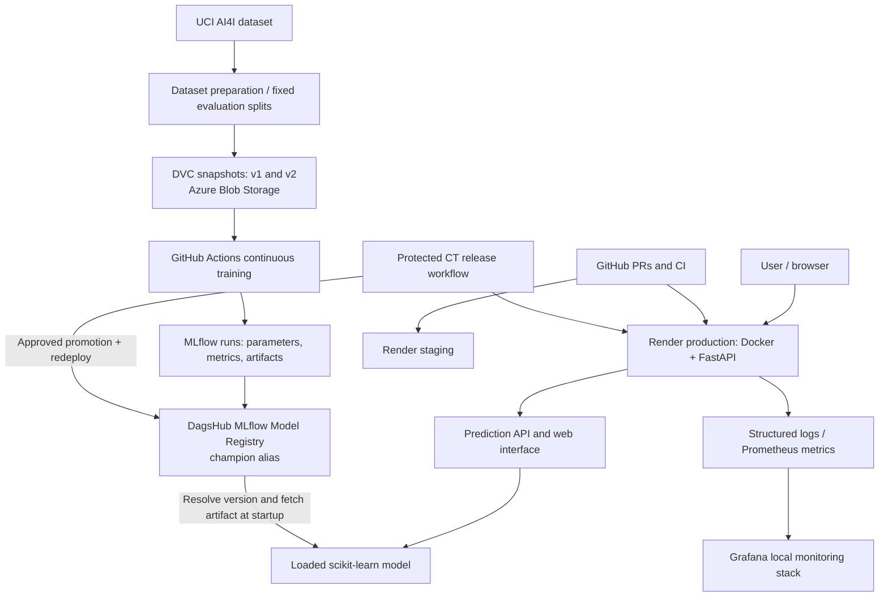

# PredictMaint AI

**Industrial Predictive Maintenance | Machine Learning in Production — Final Project**

PredictMaint AI is a Dockerized web application that estimates the probability of industrial machine failure from six operating measurements. It demonstrates a reproducible MLOps lifecycle: versioned data, experiment tracking, a shared model registry, automated tests, staging and production deployments, controlled continuous training, and model rollback.

**Live application:** [PredictMaint AI — Production](https://predictmaint-ai-production.onrender.com/)
**Interactive API documentation:** [Swagger UI](https://predictmaint-ai-production.onrender.com/docs)
**Staging application:** [Render Staging](https://predictmaint-ai-staging.onrender.com/)
**Experiment tracking and model registry:** [DagsHub / MLflow](https://dagshub.com/Abdel380/predictmaint-ai.mlflow/)

> **Model status:** On November 25, 2026, the production deployment was verified to serve approved MLflow model `predictmaint-ai`, alias `champion`, version **2**. The live endpoints below report the version currently loaded; it may change after an approved release. The service is not considered ready if the real model fails to load.

## 1. What the application does

The application predicts **machine failure (binary classification)** using the [AI4I 2020 Predictive Maintenance dataset](https://archive.ics.uci.edu/dataset/601/ai4i). The dataset contains synthetic industrial operating observations, so the application is an **academic demonstration**, not a safety-certified industrial maintenance system.

The user supplies six features:

| API field | Meaning | Unit / accepted values |
| --- | --- | --- |
| `type` | Product quality category | `L`, `M`, or `H` |
| `air_temperature` | Air temperature | Kelvin, positive |
| `process_temperature` | Process temperature | Kelvin, positive |
| `rotational_speed` | Rotational speed | rpm, positive |
| `torque` | Machine torque | Nm, non-negative |
| `tool_wear` | Tool wear | Minutes, non-negative |

The response contains a binary prediction (`0`: no predicted failure; `1`: predicted failure), a `risk_score` between 0 and 1, and the **actual model name and version used for inference**.

### Try a live prediction

```bash
curl -X POST "https://predictmaint-ai-production.onrender.com/predict" \
  -H "Content-Type: application/json" \
  -d '{
    "type": "L",
    "air_temperature": 298.1,
    "process_temperature": 308.6,
    "rotational_speed": 1500,
    "torque": 40,
    "tool_wear": 20
  }'
```

The response has the following structure (**illustrative schema; values depend on the deployed model**):

```json
{
  "failure_prediction": 0,
  "risk_score": 0.01,
  "model_name": "predictmaint-ai",
  "model_version": "2"
}
```

Open [the web interface](https://predictmaint-ai-production.onrender.com/) to submit inputs without using the command line.

### Operational endpoints

| Endpoint | Method | Purpose |
| --- | --- | --- |
| `/` | GET | User-facing prediction interface |
| `/docs` | GET | Interactive OpenAPI / Swagger documentation |
| `/predict` | POST | Real-time inference with input validation |
| `/ready` | GET | Returns HTTP 200 only when a model is loaded; otherwise HTTP 503 |
| `/model-info` | GET | Registered model name, resolved alias, and loaded version |
| `/metrics` | GET | Prometheus-compatible application and prediction metrics |

To verify the model served by production:

```bash
curl -f https://predictmaint-ai-production.onrender.com/ready
curl -f https://predictmaint-ai-production.onrender.com/model-info
```

## 2. Architecture



**Technology stack:** Python, scikit-learn, FastAPI, Pydantic, Docker, DVC with Azure Blob Storage, MLflow Model Registry and Tracking on DagsHub, GitHub Actions, Render, Prometheus, Grafana, and structured logs.

**Model loading contract:** At FastAPI startup, the service resolves the MLflow `champion` alias to a concrete model version and loads that exact artifact. It does **not** automatically hot-reload when the alias changes. A model change requires an application restart or redeployment, followed by readiness and live-prediction verification. Mock inference is explicitly enabled only for local tests (`ENABLE_MOCK_MODEL=true`).

## 3. Reproduce the application locally

### Requirements

- Git, Python 3.11, and Docker
- Internet access to reach the hosted model registry for **real** model inference
- Authorized DagsHub/MLflow credentials for **real** model inference
- Azure/DVC credentials only when reproducing data preparation or continuous training

### Option A — Docker smoke test (mock model; no cloud credentials)

```bash
git clone https://github.com/eugeniettc/final-project-ml-in-prod.git
cd final-project-ml-in-prod
docker build -t predictmaint-ai:local .
docker run --rm -p 8000:8000 -e ENABLE_MOCK_MODEL=true predictmaint-ai:local
```

In a second terminal:

```bash
curl -f http://localhost:8000/ready
curl -f http://localhost:8000/model-info
```

The mock model reports version `mock-1.0`. **It is a testing fixture, not the approved MLflow champion.** Stop the container using `Ctrl+C`.

### Option B — Local FastAPI with the real MLflow champion

```bash
python -m venv .venv
source .venv/bin/activate               # macOS / Linux
# Windows PowerShell: .venv\Scripts\Activate.ps1
pip install -r requirements.txt
```

Set the following environment variables using your shell or a **local, Git-ignored** `.env` file (never commit credentials):

```dotenv
MLFLOW_TRACKING_URI=https://dagshub.com/Abdel380/predictmaint-ai.mlflow
MLFLOW_TRACKING_USERNAME=<your_dagshub_username>
MLFLOW_TRACKING_PASSWORD=<your_dagshub_token>
MLFLOW_MODEL_NAME=predictmaint-ai
MLFLOW_MODEL_ALIAS=champion
ENABLE_MOCK_MODEL=false
```

Start and verify:

```bash
uvicorn app.main:app --host 0.0.0.0 --port 8000
# In another terminal:
curl -f http://localhost:8000/model-info
```

**Important:** `/ready` returns HTTP 503 if the approved model is unavailable; the application does not silently substitute the mock model in real-inference mode.

### Run automated tests

```bash
python -m pytest tests/ -v
python -m ruff check app ml tests --select E9,F63,F7,F82
```

The CI also builds the Docker image, starts it with a controlled mock model, and tests live HTTP endpoints. See [CI workflow](.github/workflows/ci.yml).

## 4. Data, training, and experiment tracking

The source is the **AI4I 2020 Predictive Maintenance dataset** (UCI, CC BY 4.0, synthetic observations). The two DVC dataset versions simulate a new batch of observations:

| Dataset snapshot | Training samples | Role |
| --- | ---: | --- |
| `data-v1` | 3,000 | Initial baseline |
| `data-v2` | 6,000 | New training batch (3,000 additional observations) |

The fixed validation and held-out test splits contain 2,000 records each. The test split is reserved for the predefined acceptance evaluation; champion and candidate are compared on the same held-out observations. Product identifiers and direct failure-mode indicators are excluded from model inputs to limit target leakage.

**Primary selection metric:** Average Precision (AP), appropriate for an imbalanced failure dataset (~3.39% failures). Higher is better. Supporting metrics include ROC-AUC, precision, recall and F1-score.

The documented initial approval gates include AP >= 0.40, an absolute AP improvement of at least 0.02 against the champion, recall >= 0.50 at threshold 0.5, and successful model loading and inference. These are project-specific demonstration criteria, **not industrial safety thresholds**.

For exact DVC hashes, data provenance, experiment results and current promotion policy, see:

- [Dataset and DVC versioning](ml/README_data.md)
- [MLflow experiments, metrics, and promotion decisions](ml/README_experiments.md)
- [DagsHub model registry and experiment runs](https://dagshub.com/Abdel380/predictmaint-ai.mlflow/)

## 5. Branch strategy and CI/CD workflows

The repository uses a reviewed promotion path:

```text
feature/*  ->  dev  ->  staging  ->  main
       PR        PR         PR
```

Changes are developed on short-lived `feature/*` branches created from `dev`, reviewed through Pull Requests, and promoted sequentially. CI checks run on PRs targeting `dev`, `staging`, and `main`. The long-lived branches are marked protected on GitHub; repository administrators should verify the required status checks and review rules in branch settings.

| Workflow | Trigger | Action / validation |
| --- | --- | --- |
| [`ci.yml`](.github/workflows/ci.yml) | PR to `dev`, `staging`, or `main`; push to these branches; manual dispatch | Python syntax, Ruff critical checks, pytest, Docker build, mock-container smoke test |
| [`staging.yml`](.github/workflows/staging.yml) | Push to `staging`; manual dispatch | Validate build/tests, deploy Render staging, verify public readiness, model version, and prediction |
| [`production.yml`](.github/workflows/production.yml) | Push to `main`; manual dispatch | Validate build/tests, deploy Render production for the expected Git SHA, verify the live MLflow champion and prediction |
| [`continuous-training.yml`](.github/workflows/continuous-training.yml) | Push/PR to `dev`; manual dispatch with `dataset_version` and `ct_mode` | Test ML logic; validate Azure/DVC datasets; verify champion; execute a controlled training/evaluation and **read-only promotion check** when eligible |
| [`ct-production-release.yml`](.github/workflows/ct-production-release.yml) | Manual dispatch on `main`, with `ct_run_id` and `release_mode` | Preflight comparison; optional protected promotion, Render redeployment and recovery logic |
| [`production-model-monitor.yml`](.github/workflows/production-model-monitor.yml) | Scheduled; manual dispatch; completed production deployment/release workflow | Check that the live version matches the MLflow champion |

**Continuous-training release boundary:** Training and comparison do **not** automatically modify the production champion. The separate, explicitly authorized `CT Production Release` workflow performs a real promotion only after its preflight and production-environment authorization. A candidate that fails the quality gates must leave the champion unchanged and log the rejection reason.

For credentials, deployment reproduction, branch flow, and production incident handling, see [Deployment and Twelve-Factor documentation](DEPLOYMENT.md).

### Verified CI/CD evidence

- [Rollback implementation and tests — PR #14](https://github.com/eugeniettc/final-project-ml-in-prod/pull/14)
- [Staging validation — PR #15](https://github.com/eugeniettc/final-project-ml-in-prod/pull/15)
- [Production rollout — PR #16](https://github.com/eugeniettc/final-project-ml-in-prod/pull/16)
- [Production deploy with a live prediction and champion v2](https://github.com/eugeniettc/final-project-ml-in-prod/actions/runs/45695248713)
- [Production model synchronization monitor](https://github.com/eugeniettc/final-project-ml-in-prod/actions/runs/45696050322)

The deployment workflow verified the expected Git commit as live on Render and a successful production prediction with model version **2** (November 25, 2026). The Docker image is currently built with an environment label such as `predictmaint-ai:production`; commit-based **image tagging/digest pinning** is a separate DevOps compliance check, not something this README claims is already in place.

## 6. Rollback and failure recovery

`ml/rollback.py` supports a dry-run (default) and an explicit `--execute` flag. It verifies the expected current champion, the previous approved version, MLflow registration/provenance and a local inference check **before** changing the alias. The application must then restart/redeploy and pass live HTTP verification.

A controlled demonstration used the isolated registry model `predictmaint-ai-ct-demo-henri-fixed`, restoring champion **v4 -> v1**, then reloading FastAPI and verifying `/model-info` and `/predict` locally. **No rollback was performed on the production Render model.**

- [Complete rollback commands and incident runbook](DEPLOYMENT.md#4-mlflow-model-rollback)
- [MLflow rollback audit run](https://dagshub.com/Abdel380/predictmaint-ai.mlflow/#/experiments/2/runs/62ee72d6e93a41de99705dbedd304dcd)

The protected CT release code also includes automatic recovery if a newly promoted model cannot be deployed successfully; failure-and-recovery on the hosted production service has not yet been demonstrated end to end.

## 7. Observability

FastAPI exposes `/metrics` for Prometheus and emits structured inference/application logs. A local Docker Compose stack can start the API, Prometheus and Grafana for dashboard and replay experiments.

See [Monitoring setup and demonstration](monitoring/README.md) and [Grafana dashboard definition](monitoring/dashboard.json). Monitoring dashboards and SMTP alerts require local configuration and are not presented here as publicly hosted services.

## 8. Documentation map

| Document | Description |
| --- | --- |
| [`DEPLOYMENT.md`](DEPLOYMENT.md) | Twelve-Factor methodology, Docker, Render CI/CD, rollback and failure-recovery runbook |
| [`ml/README_data.md`](ml/README_data.md) | Dataset source/license, fixed splits, v1/v2, DVC hashes and Azure remote |
| [`ml/README_experiments.md`](ml/README_experiments.md) | MLflow experiments, baseline metrics, candidate policy and evidence |
| [`monitoring/README.md`](monitoring/README.md) | Prometheus/Grafana and traffic simulation setup |
| [`.github/workflows/`](.github/workflows/) | Exact GitHub Actions definitions and triggers |

## 9. Project team

- **Abdellah H'LALI**
- **Henri SU**
- **Eugénie TITOUCHE**

*EFREI — Machine Learning in Production final-year project (2026).*
